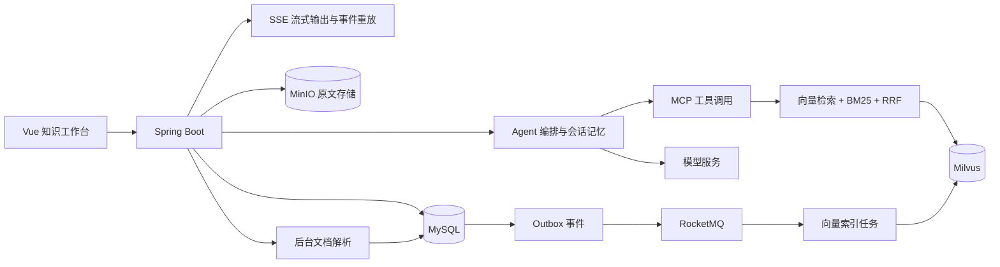

# 知衡 Agent · agent-rag-lite

面向企业制度与流程查询的智能知识助手，使用 Java 与 Vue 构建，覆盖文档导入、混合检索、工具调用、会话记忆和流式问答。用户可以上传制度文档，直接提问并查看答案依据。

## 功能

- 上传 Markdown、TXT、DOCX、文本型 PDF；MinIO 保存原件，后台解析、分块并建立索引。
- Milvus 向量检索与 BM25 混合召回，RRF 融合，可选模型精排。
- Function Calling、MCP 工具发现与调用、完整文档读取。
- MySQL 保存会话、长期记忆和可重放的 SSE 事件；支持断线续传。
- Outbox 与 RocketMQ 驱动索引任务，支持文档版本更新、删除和失败补偿。
- 有界并发接入、同一会话串行、身份隔离及管理员文档管理。

## 架构与工程设计



- **文档更新的一致性**：原文、解析结果和索引任务按版本关联，新版本完成索引后切换生效版本，避免半成品进入检索。
- **检索效率与质量**：HNSW 向量索引结合 BM25 倒排索引，融合语义相关性与关键词匹配；BM25 索引按已发布文档版本更新，复用索引快照。
- **可恢复的流式交互**：任务与事件持久化，客户端通过事件编号恢复输出；生成任务支持取消，同一会话避免并发写入。
- **可追溯的长期记忆**：保存用户事实和偏好，同时记录来源；按用户隔离召回，并限制进入模型的记忆数量和上下文长度。
- **异步任务治理**：Outbox 配合消息队列完成索引分发，通过幂等处理、失败重试和对账补偿维护数据一致性。
- **完整交付**：前端构建产物打入 JAR，统一部署依赖与启动入口，支持本地构建和运行。

## 环境准备

安装 JDK 21、Maven 3.9、Node.js 22.12+ 或 24、Docker Compose v2 和 Ollama。建议至少 16 GB 内存；模型的速度取决于 CPU、GPU 和可用显存。

以下步骤都在解压后的仓库根目录执行，不要求固定磁盘或目录。应用和 Ollama 在宿主机运行，Docker 运行数据库等依赖。

### 1. 启动依赖和模型

```sh
docker compose up -d --wait --wait-timeout 240
ollama pull qwen3:4b-instruct
ollama pull qwen3-embedding:0.6b
```

Ollama 桌面版启动后会提供本地接口；如果安装的是命令行版且服务未运行，另开终端执行 `ollama serve`。首次下载镜像和模型需要联网。Compose 一次启动 MySQL、Redis、etcd、MinIO、Milvus、RocketMQ NameServer 和 Broker，无需另装 Redis 或单独启动消息队列。

| 服务 | 本机默认端口 |
| --- | --- |
| 应用 | 8080 |
| Ollama | 11434 |
| MySQL | 23306 |
| Redis | 26379 |
| MinIO / 控制台 | 9000 / 9001 |
| Milvus / 健康检查 | 19530 / 9091 |
| RocketMQ NameServer / Broker | 9876 / 10911 |

端口已被占用时，先检查已有服务，或复制 `.env.example` 为 `.env` 后修改。Compose 会自动读取 `.env`；下文的应用启动脚本也会读取它。

### 2. 构建

```sh
cd frontend
npm ci
npm run build
cd ..
mvn clean package
```

必须先构建前端。生成的页面会一起打入 `target/agent-rag-lite-0.0.1-SNAPSHOT.jar`，运行时不需要 Node.js 或单独的前端服务器。

### 3. 启动应用

Windows PowerShell：

```powershell
./deploy/local.ps1
```

Linux / macOS：

```sh
sh deploy/local.sh
```

不需要自定义参数时，也可以直接执行：

```sh
java -Xms256m -Xmx1024m -jar target/agent-rag-lite-0.0.1-SNAPSHOT.jar
```

Spring Boot 本身不会读取 `.env`。直接运行 JAR、Maven 或 IDE 时，请自行设置环境变量；启动脚本用于代为加载本地配置。修改 `.env` 后重启应用；修改容器配置后重新执行 `docker compose up -d --wait`。

### 4. 使用工作台

打开 <http://localhost:8080/console/>。进入“文档管理”，填写演示管理员令牌 `local-admin-token` 并点击“应用”，上传文档。等待状态变成 `READY`，再进入“知识问答”提问。问答默认使用演示用户令牌 `local-user-token`，可在引用区查看回答依据。

服务健康检查：<http://localhost:8080/api/system/health>。

## 配置和排障

- 本地默认值可直接启动。完整配置项见 `src/main/resources/application.yml`，常用配置见 `.env.example`。
- 原文、业务数据、向量、消息分别保存在 Compose 的独立数据卷中。`docker compose down` 停止容器且保留数据；不要随意添加 `-v`。
- **WSL / 远程 Docker**：README 默认面向 Docker Desktop 或应用与 Docker 同在 Linux 主机的情况。Windows 运行 Java、WSL 运行 Docker 时，先确认宿主机能访问映射端口。若 localhost 转发不可用，在 `.env` 中把数据库、Milvus、MinIO、RocketMQ 地址改为可达的 WSL 地址，并将 `HOST_BIND_IP` 设为对应 WSL 网卡地址。`BROKER_ADVERTISED_HOST` 必须是 Java 能访问的同一地址，改完要重建 Broker；仅修改 NameServer 地址不足以解决 Broker 连接失败。
- 上传停在解析或索引阶段：检查文档详情中的错误、`docker compose ps`、`docker compose logs rocketmq-broker`，以及 Ollama 是否已安装嵌入模型。
- 换嵌入模型时，同时修改 `EMBEDDING_DIMENSION` 和 `MILVUS_COLLECTION`，使用新集合并重新导入；不要把不同维度或不同模型的向量混在旧集合里。
- 扫描型 PDF 不含可提取文本，本项目不提供 OCR。
- 默认密码和固定令牌用于本地演示，依赖端口默认只绑定本机。对外部署前应配置认证、网络入口和独立凭证；`deploy/.env.production.example` 与 `application-prod.yml` 提供配置入口。`prod` 不会自动建表，应先在目标数据库执行 `src/main/resources/db/init.sql`。

## 目录

| 路径 | 用途 |
| --- | --- |
| `src/main/` | Java 服务、数据库结构与应用配置 |
| `frontend/` | Vue 工作台源码和依赖锁文件 |
| `deploy/` | 应用启动脚本、Broker 与生产配置示例 |
| `docker-compose.yml` | 本地依赖的完整启动配置 |
